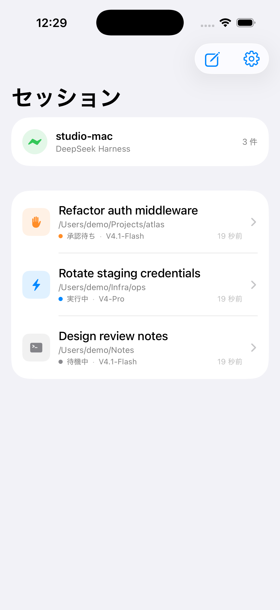
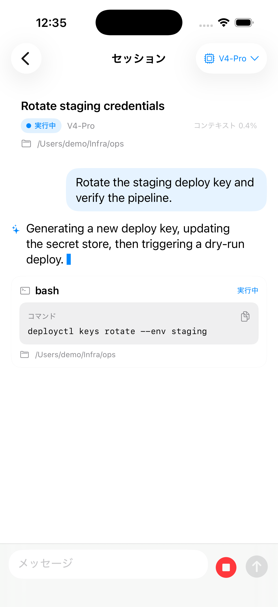
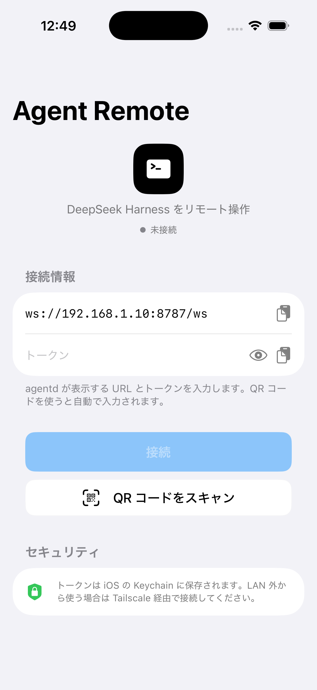
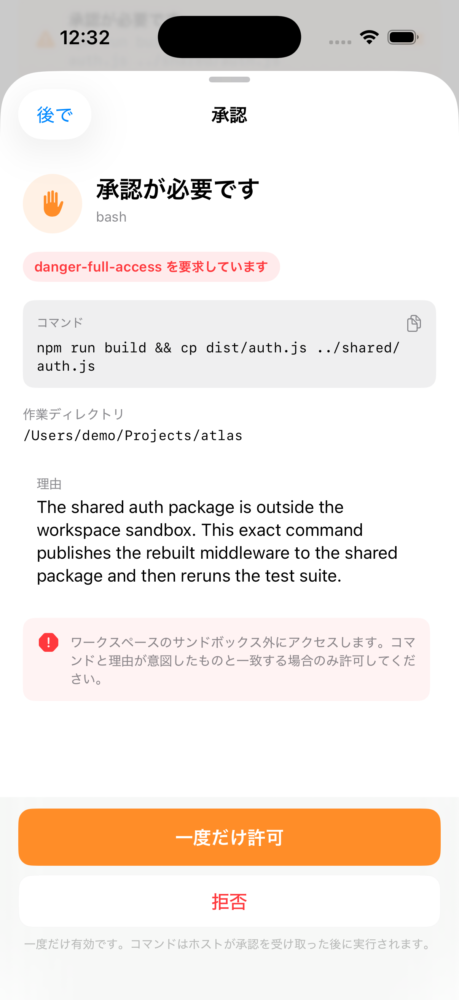

# Agent Remote

**日本語** | [English](README.md)

[](https://github.com/4uthen7/agent-remote/releases)
[](LICENSE)
[](https://developer.apple.com/ios/)
[](https://nodejs.org/)

Mac 上で動くコーディングエージェントを、iPhone から操作するためのネイティブアプリです。
iPhone は Node 製の小さなデーモン `agentd` にトークン認証付き WebSocket で接続し、
エージェントの出力をリアルタイムで表示しながら、サンドボックス昇格の承認を
スマートフォンから行えます。

公開しているアプリは **日本語のクリーンなネイティブ UI** です。以前のサイバー調・3D の
実験 UI はこのリポジトリには含まれていません。

| セッション | タイムライン |
|---|---|
|  |  |

| 接続 | 承認 |
|---|---|
|  |  |

## 機能

- **3つのランタイム** — **DeepSeek Harness** / **OpenAI Codex** / **Claude Code** をセッションごとに選択
- **セッション操作** — セッション一覧、作成、再開、終了
- **リアルタイム出力** — アシスタントの文章、思考、ツール呼び出し、コマンド出力、コンテキスト使用率
- **ワンタップ承認** — 実行コマンド、作業ディレクトリ、理由、`danger-full-access` 昇格を確認して一度だけ許可
- **モデル切替** — セッション画面から、選択中ランタイムのモデルを変更
- **ネイティブ iOS UI** — SwiftUI、grouped list、Large Title、SF Symbols、システムのライト/ダーク、日本語ラベル
- **アプリアイコン** — 接続画面の黒いターミナルマークを同梱
- **安全なペアリング** — QR コードまたは URL + トークン。トークンは iOS の Keychain に保存
- **LAN / Tailscale** — Mac 側に inbound ポートを開けずに、tailnet 経由で外部から接続

## 構成

```
┌────────────────────┐        WebSocket (token)        ┌────────────────────┐
│ iPhone             │◀───────────────────────────────▶│ agentd             │
│ SwiftUI            │                                 │ Node + TypeScript  │
└────────────────────┘                                 └─────────┬──────────┘
                                                                 │ 正規化イベント
                                              ┌──────────────────┼──────────────────┐
                                       ┌──────▼──────┐   ┌───────▼──────┐   ┌───────▼──────┐
                                       │ dsh acp     │   │ codex        │   │ Claude Agent │
                                       │ DeepSeek    │   │ app-server   │   │ SDK          │
                                       └─────────────┘   └──────────────┘   └──────────────┘
```

`agentd` はセッションで選ばれたランタイムだけを遅延起動し、クライアントに依存しない
upstream プロセスとして維持します。iPhone アプリは各ランタイムに直接接続しません。

- **DSH** — 生成した ACP プロファイルを stdio で起動
- **Codex** — `codex app-server --listen stdio://`。承認はワンショット
- **Claude** — `@anthropic-ai/claude-agent-sdk` の `canUseTool` を同じ承認シートに変換

メッセージフローと承認の相関処理は [docs/architecture.md](docs/architecture.md) を参照してください。

## 必要なもの

- macOS で、少なくとも1つのランタイムが利用可能:
  - [DeepSeek Harness](https://github.com/deepseek-ai) がインストール・ログイン済み
  - **Codex CLI** がログイン済み（`codex login status` が ChatGPT と表示）
  - **Claude Code** がログイン済み（`claude auth status`）または `ANTHROPIC_API_KEY`
- Node.js 22 以上（開発は Node 24）
- Xcode 26 以上と [XcodeGen](https://github.com/yonaskolb/XcodeGen)
- Mac と同じ LAN、または両方を Tailscale に接続した iPhone

DSH `0.2.1-rc.2`、Codex CLI `0.144.6`、Claude Code `2.1.216` / macOS で動作確認しています。
Claude はログインまたは API キーが必要で、未認証の場合はアプリにエラーが表示されます。

## クイックスタート

### 1. agentd を起動

```bash
cd agentd
npm install
npm start
```

WebSocket URL、トークン、ペアリング QR が表示されます。プロセスは起動したままにします。

- DSH のログインは `~/.dsh`
- Codex のログインは `~/.codex`
- Claude Code のログインは `~/.claude`
- トークンと生成 ACP パッチは `~/.agent-remote`
- 権限モードは **workspace-write**。サンドボックス昇格は必ず iPhone に承認要求が届きます

### 2. iOS アプリをビルド

```bash
cd ios
xcodegen generate
open AgentRemote.xcodeproj
```

Team を設定し、必要なら Bundle ID を変更して実機で実行します。Sideloadly / AltStore 用の
署名なし IPA を作る場合:

```bash
cd ..
./scripts/build-ipa.sh
# build/ipa/AgentRemote.ipa
```

IPA は署名されていません。Sideloadly または AltStore が Apple ID で再署名します。
詳細は [docs/install.ja.md](docs/install.ja.md)。

### 3. ペアリング

アプリで **QR コードをスキャン** を開き、agentd のターミナルに出ている QR を読み取ります。
手入力する場合:

- URL: agentd が表示する LAN URL（例 `ws://192.168.1.10:8787/ws`）
- トークン: `cat ~/.agent-remote/token`

iPhone から見た `127.0.0.1` は iPhone 自身なので使えません。
LAN 外から使う場合は、Mac と iPhone の両方を Tailscale に入れ、tailnet の IP を使います:

```bash
AGENT_REMOTE_PUBLIC_URL="ws://$(tailscale ip -4):8787/ws" npm start
```

### 4. セッションを作成

ペアリング後に右上の作成ボタンを押し、**DeepSeek Harness / Codex / Claude Code** を選びます。
タイムライン、モデルメニュー、承認シートは3つとも同じUIです。ランタイムが未ログインの
場合は、そのランタイムのエラーだけが表示され、agentd 全体は止まりません。

## セキュリティ

- `agentd` はすべての WebSocket 接続を bearer token で認証します
- トークンは iOS Keychain（`AfterFirstUnlockThisDeviceOnly`）に保存されます
- 承認は **一度だけ** 有効で、実際に要求したツール呼び出し・コマンドに紐づきます。
  `danger-full-access` は明示表示され、自動承認されません
- `agentd` はデフォルトで `0.0.0.0:8787` をリッスンします。インターネットに直接公開せず、
  Tailscale または認証付き TLS プロキシ経由で使用してください
- 現在の LAN 内 transport は `ws://` です。アプリ層の E2E と relay はロードマップにあります。
  `NSAllowsArbitraryLoads` はローカル開発用で、広く配布する前に `wss://` へ移行してください
- `agentd` は macOS ユーザーの権限で動きます。承認内容はターミナルで実行する場合と
  同じ強さで確認してください

脅威モデルと脆弱性の報告方法は [SECURITY.md](SECURITY.md) を参照してください。

## プライバシー

- iOS アプリには **解析・広告・第三者 SDK は入っていません**
- 接続先は、あなたが入力または QR で指定した `agentd` だけです。ベンダーのサーバーはありません
- プロンプト、ファイル、モデル出力は、iPhone・Mac・選択中ランタイムのモデル提供元の間だけを流れます
- ペアリング用トークンは iOS の Keychain と Mac の `~/.agent-remote/token` に保存され、このリポジトリや Release IPA には含まれません

## 設定

| 変数 | デフォルト | 用途 |
|---|---|---|
| `AGENT_REMOTE_PORT` | `8787` | WebSocket / HTTP ポート |
| `AGENT_REMOTE_BIND` | `0.0.0.0` | bind アドレス。プロキシ背後なら `127.0.0.1` |
| `AGENT_REMOTE_HOME` | `~/.agent-remote` | トークンと生成 ACP パッチ |
| `AGENT_REMOTE_TOKEN` | 自動生成 | 固定 bearer token |
| `AGENT_REMOTE_ROOTS` | `$HOME` | 許可する作業ディレクトリ（`:` 区切り） |
| `AGENT_REMOTE_PUBLIC_URL` | LAN URL | QR に埋め込む URL |
| `DSH_HOME` | `~/.dsh` | DeepSeek Harness の home |
| `AGENT_REMOTE_DSH_PROFILE` | `acp` | DSH プロファイル名 |
| `DSH_PROVIDER` | `deepseek-account` | DSH プロバイダ |
| `DSH_MODEL` | `deepseek-flash` | デフォルトモデル |
| `DSH_BIN` / `DSH_APP_PATH` | 自動 | DSH ランタイムの明示指定 |
| `CODEX_BIN` | `codex` | Codex CLI のパス |
| `AGENT_REMOTE_CLAUDE_MODEL` | `sonnet` | Claude のデフォルトモデル |

## 開発

DSH を起動せずに UI を確認できるモックデーモン:

```bash
cd agentd
node test/mock-server.mjs
# ws://127.0.0.1:8788/ws, token "demo"
```

シミュレータでは `AGENT_REMOTE_URL=ws://127.0.0.1:8788/ws`、
`AGENT_REMOTE_TOKEN=demo` を環境変数で渡すか、アプリ内で入力します。

実 DSH に接続した状態での smoke test:

```bash
cd agentd
node test/smoke.mjs
```

セッション作成、prompt、モデル切替、一時ファイルを書き込むコマンドの承認までを確認します。

## ステータス / ロードマップ

- [x] DSH ACP アダプタ、ストリーミング、承認、モデル切替、resume
- [x] Codex `app-server` アダプタ（コマンド承認）
- [x] Claude Agent SDK アダプタ（`canUseTool` 承認）
- [x] ランタイム選択（DSH / Codex / Claude）とランタイム別モデルメニュー
- [x] ネイティブ iOS クライアント、QR ペアリング、Keychain、Tailscale 対応
- [x] 日本語クリーン UI、署名なし IPA
- [x] アプリアイコン（黒いターミナルマーク）
- [ ] アプリ層 E2E + relay
- [ ] APNs プッシュ通知
- [ ] アプリアイコン / App Store 向け hardening

## リポジトリ構成

```
agentd/                 Node デーモン（WebSocket + DSH / Codex / Claude）
ios/                    SwiftUI アプリ（XcodeGen）
  AgentRemote/          クリーン UI + 共有クライアント
scripts/build-ipa.sh    署名なし実機 IPA
docs/                   インストール、構成、スクリーンショット
```

## ライセンス

MIT — [LICENSE](LICENSE) を参照してください。
