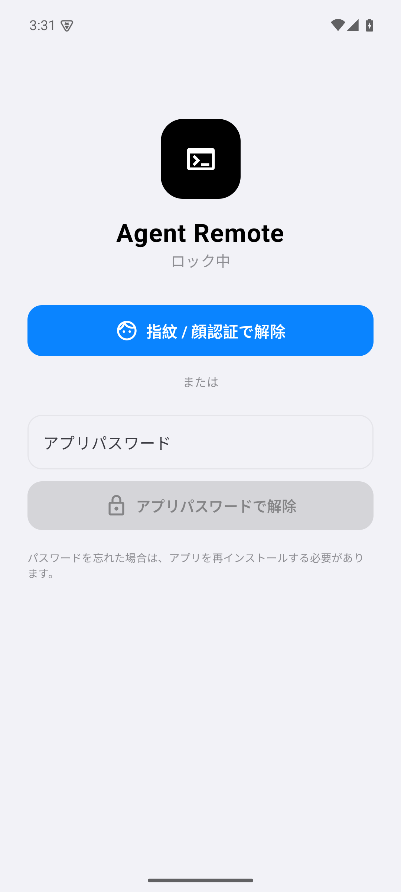
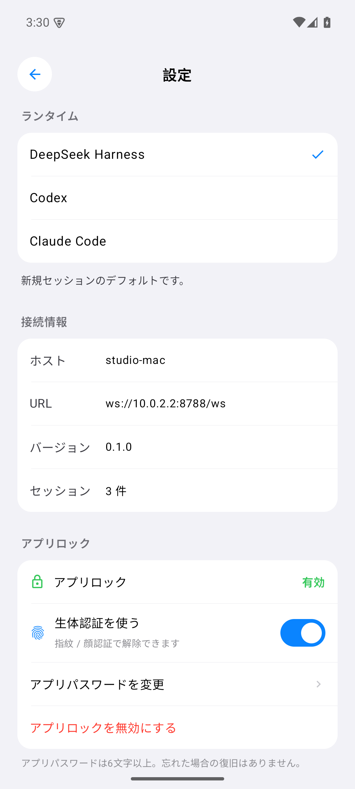

# Agent Remote

**日本語** | [English](README.md)

[](https://github.com/4uthen7/agent-remote/releases)
[](LICENSE)
[](https://developer.apple.com/ios/)
[](https://developer.android.com/)
[](docs/platforms.md)
[](https://nodejs.org/)
[](https://github.com/4uthen7/agent-remote/actions/workflows/cross-platform.yml)

PC 上で動くコーディングエージェントを、**iPhone / Android** から操作するための
ネイティブアプリです。どちらも Node 製の小さなデーモン `agentd` にトークン認証付き
WebSocket で接続し、エージェントの出力をリアルタイムで表示しながら、サンドボックス
昇格の承認をスマートフォンから行えます。

公開しているアプリは **日本語のクリーンなネイティブ UI** です。iOS は SwiftUI、
Android は Jetpack Compose で実装しています。以前のサイバー調・3D の実験 UI は
このリポジトリには含まれていません。

## デスクトップホストアプリ（Node.js不要）

もっとも簡単なホスト起動方法は **Agent Remote Desktop**（Windows / macOS）です。
Node、`agentd`、依存関係を同梱し、PCに入っているDSH / Codex / Claudeを検出して
サーバーを起動、ペアリングQRを表示します。PC側にNode.jsを入れる必要はありません。

- [Releases](https://github.com/4uthen7/agent-remote/releases) から
  `AgentRemote-Setup-<version>.exe` または `Agent.Remote-<version>-arm64.dmg` を取得
- 署名なしのため、Windowsは「詳細情報 → 実行」、macOSは右クリック→「開く」
- 操作できるのはDSH / Codex / Claude Codeです。Cursor、VS Code、Windsurf、Aider、
  Gemini CLI、OpenCodeは検出のみ（アダプタ未対応）
- コーディングCLI自体の自動インストール・認証は行いません。各ツールを通常どおり
  インストールして一度ログインしてください。アプリ本体はNode/npm不要です

ビルド方法と制限: [desktop/README.md](desktop/README.md)

| セッション | タイムライン |
|---|---|
|  |  |

| 接続 | 承認 |
|---|---|
|  |  |

| Android セッション | Android セットアップガイド | Android 承認 |
|---|---|---|
|  |  |  |

| Android アプリロック | Android アプリロック設定 |
|---|---|
|  |  |

## 機能

- **3つのランタイム** — **DeepSeek Harness** / **OpenAI Codex** / **Claude Code** をセッションごとに選択
- **セッション操作** — セッション一覧、作成、再開、終了
- **リアルタイム出力** — アシスタントの文章、思考、ツール呼び出し、コマンド出力、コンテキスト使用率
- **ワンタップ承認** — 実行コマンド、作業ディレクトリ、理由、`danger-full-access` 昇格を確認して一度だけ許可
- **モデル切替** — セッション画面から、選択中ランタイムのモデルを変更
- **ネイティブクライアント** — iOS は SwiftUI、Android は Jetpack Compose。grouped list、Large Title、システムのライト/ダーク、日本語ラベル
- **デバッグ可能な Android APK** — debug 署名・debuggable。`adb install` で導入でき、ストア署名は不要
- **進行に合わせたセットアップガイド** — 左上の `?` ボタンがホストURL・QR・次の手順を案内。接続やセッションの進捗に応じて内容が変わります
- **アプリロック** — iOSはFace ID / Touch ID / Optic ID、Androidは指紋・顔認証、さらにアプリ専用パスワードに対応。起動時とバックグラウンド復帰時にロックし、**設定 → アプリロック** から有効化
- **セッション履歴と再開** — `agentd` を再起動しても会話が残り、アプリではプロジェクト単位で表示。終了したセッションも履歴を読み込んで再開できます
- **擬似クラウド同期** — クラウド同期フォルダを使う方法と、同梱の暗号化リレーサーバーで同じルームに参加する方法に対応。接続中ホストのセッションは再開でき、別ホストの履歴は読み取り専用で表示します
- **アプリアイコン** — 接続画面の黒いターミナルマークを同梱
- **安全なペアリング** — QR コードまたは URL + トークン。トークンは iOS の Keychain / Android の Keystore 暗号化領域に保存
- **LAN / Tailscale** — Mac 側に inbound ポートを開けずに、tailnet 経由で外部から接続

## 構成

```
┌────────────────────┐        WebSocket (token)        ┌────────────────────┐
│ iPhone / Android   │◀───────────────────────────────▶│ agentd             │
│ SwiftUI            │                                 │ Node + TypeScript  │
└────────────────────┘                                 └─────────┬──────────┘
                                                                 │ 正規化イベント
                                              ┌──────────────────┼──────────────────┐
                                       ┌──────▼──────┐   ┌───────▼──────┐   ┌───────▼──────┐
                                       │ dsh acp     │   │ codex        │   │ Claude Agent │
                                       │ DeepSeek    │   │ app-server   │   │ SDK          │
                                       └─────────────┘   └──────────────┘   └──────────────┘
```

`agentd` はセッションで選ばれたランタイムだけを遅延起動し、クライアントに依存しない
upstream プロセスとして維持します。iPhone / Android アプリは各ランタイムに直接接続しません。

- **DSH** — 生成した ACP プロファイルを stdio で起動
- **Codex** — `codex app-server --listen stdio://`。承認はワンショット
- **Claude** — `@anthropic-ai/claude-agent-sdk` の `canUseTool` を同じ承認シートに変換

メッセージフローと承認の相関処理は [docs/architecture.md](docs/architecture.md) を参照してください。

## ホストOSとスマホの組み合わせ

ホスト側 daemon は macOS 専用ではなく、スマホアプリも特定のホストOSに依存しません。

| ホスト | iPhone | Android |
|---|---|---|
| macOS 13+ | ✅ | ✅ |
| Windows 10 1809+ / 11 | ✅ | ✅ |
| Linux | ✅ | ✅ |

QR・URL + トークン・承認・モデルメニューはどの組み合わせでも同じです。詳細は
[docs/platforms.md](docs/platforms.md)、Windows の手順は
[docs/windows.md](docs/windows.md)（ファイアウォール、`dsh`/Codex/Claude、WSL2 フォールバック）
を参照してください。Windows は CI の `windows-latest` で agentd の起動・health まで検証します。

## 必要なもの

- macOS 13+ / Windows 10 1809+ / Linux で、少なくとも1つのランタイムが利用可能:
  - [DeepSeek Harness](https://github.com/deepseek-ai) がインストール・ログイン済み
  - **Codex CLI** がログイン済み（`codex login status` が ChatGPT と表示）
  - **Claude Code** がログイン済み（`claude auth status`）または `ANTHROPIC_API_KEY`
- Node.js 22.19 以上（Node 24 推奨）
- Xcode 26 以上と [XcodeGen](https://github.com/yonaskolb/XcodeGen)
- ホストと同じ LAN、または両方を Tailscale に接続した iPhone / Android 8 以上
- ソースから Android をビルドする場合のみ JDK 17 + Android SDK 35

DSH `0.2.1-rc.2`、Codex CLI `0.144.6`、Claude Code `2.1.216` / macOS で動作確認しています。
Windows は CI（`windows-latest`）で型チェックと agentd 起動を検証しています。各ランタイムの
CLI は Windows ホスト側でインストール・ログインしてから使ってください。
Claude はログインまたは API キーが必要で、未認証の場合はアプリにエラーが表示されます。

## セッション履歴と再開

`agentd` はセッションの要約、ネイティブランタイムID、設定、タイムラインを
`AGENT_REMOTE_SYNC_DIR` に保存します。起動時には既存のネイティブ履歴も自動で取り込みます
（Codexスレッド、Claude Codeのトランスクリプト、DSHのターン概要）。アプリは実行中・
終了済みのセッションを作業ディレクトリ（プロジェクト）ごとに表示し、終了したセッションを
開いて履歴を読んだり、**再開** してDSH / Codex / Claudeの続きを実行できます。

このローカル取り込みは自動です。**ホスト間の同期はオプトイン**で、リレーまたは共有
アーカイブフォルダを設定した場合だけ行われます。ルームキーがなければ履歴は外部に送られません。

ネイティブセッションの再開は、そのランタイムの状態があるホストに接続している場合のみ
可能です。クラウド共有フォルダ経由で別ホストの履歴を読む場合は読み取り専用になり、
所有ホスト名が表示されます。クラウド同期フォルダを指定すると擬似クラウド同期になります:

```bash
AGENT_REMOTE_SYNC_DIR="$HOME/Library/Mobile Documents/com~apple~CloudDocs/AgentRemote" npm start
```

### 暗号化リレー同期

リポジトリには小さなリレーサーバーも同梱されています。サーバーが保存するのは
AES-256-GCMの暗号文だけで、ルームキーはサーバーに送られません。

```bash
# 常時起動する1台（またはVPS・リバースプロキシ先）
AGENT_REMOTE_SYNC_TOKEN="server-token" npm run sync-server

# 同じルームに参加する各agentd
export AGENT_REMOTE_SYNC_URL="https://sync.example.com"
export AGENT_REMOTE_SYNC_ROOM="my-team"
export AGENT_REMOTE_SYNC_KEY="十分に長いプライベートなルームキー"
export AGENT_REMOTE_SYNC_TOKEN="server-token"
npm start
```

GitHubから導入した人も同じ機能を使えます。同じ履歴を見るには **同じリレーURL・
ルーム・キー** を設定する必要があり、これらは公開リポジトリには含めません。キーが
なければリレー側には暗号文しか見えません。別ホストのセッションは読み取り専用で、
再開するには所有ホストに接続します。

履歴にはプロンプト、ツール出力、パスが含まれるため、プライベートな暗号化フォルダ
またはプライベートなリレーを使い、ルームキーを公開しないでください。

## バージョン

各リリースは Git タグと GitHub Release で管理しています。1つのリリース内でアプリと
daemon のバージョンが異なる場合があります。履歴は [CHANGELOG.md](CHANGELOG.md)、
対応表は [docs/platforms.md](docs/platforms.md) を参照してください。

## クイックスタート

### 1. agentd を起動

macOS / Linux:

```bash
cd agentd
npm install
npm start
```

Windows（PowerShell）は [docs/windows.md](docs/windows.md) を参照:

```powershell
cd agentd
npm ci
npm start
```

WebSocket URL、トークン、ペアリング QR が表示されます。プロセスは起動したままにします。

- DSH のログインは `~/.dsh`
- Codex のログインは `~/.codex`
- Claude Code のログインは `~/.claude`
- トークンと生成 ACP パッチは `~/.agent-remote`
- 権限モードは **workspace-write**。サンドボックス昇格は必ずスマートフォンに承認要求が届きます

### 2. アプリをビルド

```bash
cd ios
xcodegen generate
open AgentRemote.xcodeproj
```

Team を設定し、必要なら Bundle ID を変更して実機で実行します。Sideloadly / AltStore 用の
署名なし IPA を作る場合:

```bash
cd ..
./scripts/build-ipa.sh
# build/ipa/AgentRemote.ipa
```

IPA は署名されていません。Sideloadly または AltStore が Apple ID で再署名します。
詳細は [docs/install.ja.md](docs/install.ja.md)。

#### Android

リリースの `AgentRemote-android-debug.apk` をインストールするか、ソースからビルドします:

```bash
cd android
./gradlew assembleDebug
adb install -r app/build/outputs/apk/debug/app-debug.apk
```

**debug ビルド**（debuggable / 標準 Android debug key 署名）です。パッケージ名は
`dev.fouruthent.agentremote` で、iOS 版とは別アプリとして共存します。

#### ホストURLには何を入れる？

agentd が表示する `WebSocket:` の行を使います:

| 状況 | ホストURL |
|---|---|
| 実機（同じWi-Fi） | `ws://<ホストのLAN IP>:8787/ws`（例 `ws://192.168.1.10:8787/ws`） |
| Tailscale | `ws://<tailscale IP>:8787/ws` |
| Androidエミュレータ | `ws://10.0.2.2:8787/ws` |

スマートフォンで `127.0.0.1` / `localhost` は使えません。一番簡単なのは agentd の
ターミナルに出るQRをスキャンする方法で、URLとトークンが自動で入ります。左上の `?`
ボタンのガイドは、開始 → QR/ホスト → トークン → 接続 → セッション → 承認の進捗に
合わせて案内内容が変わります。

### 3. ペアリング

アプリで **QR コードをスキャン** を開き、agentd のターミナルに出ている QR を読み取ります。
手入力する場合:

- URL: agentd が表示する LAN URL（例 `ws://192.168.1.10:8787/ws`）
- トークン: `cat ~/.agent-remote/token`

スマートフォンから見た `127.0.0.1` は端末自身なので使えません。
LAN 外から使う場合は、PC とスマートフォンの両方を Tailscale に入れ、tailnet の IP を使います:

```bash
AGENT_REMOTE_PUBLIC_URL="ws://$(tailscale ip -4):8787/ws" npm start
```

### 4. セッションを作成

ペアリング後に右上の作成ボタンを押し、**DeepSeek Harness / Codex / Claude Code** を選びます。
タイムライン、モデルメニュー、承認シートは3つとも同じUIです。ランタイムが未ログインの
場合は、そのランタイムのエラーだけが表示され、agentd 全体は止まりません。

## セキュリティ

- `agentd` はすべての WebSocket 接続を bearer token で認証します
- トークンは iOS Keychain（`AfterFirstUnlockThisDeviceOnly`）または Android Keystore 暗号化領域に保存されます
- アプリロックはソルト付き PBKDF2-HMAC-SHA256（120,000回）のパスワードハッシュのみを保存します（iOSはKeychain、Androidはアプリ専用領域）。UIのロックであり、WebSocketトークンはKeychain/Keystoreで保護されます
- 承認は **一度だけ** 有効で、実際に要求したツール呼び出し・コマンドに紐づきます。
  `danger-full-access` は明示表示され、自動承認されません
- `agentd` はデフォルトで `0.0.0.0:8787` をリッスンします。インターネットに直接公開せず、
  Tailscale または認証付き TLS プロキシ経由で使用してください
- 現在の LAN 内 transport は `ws://` です。アプリ層の E2E と relay はロードマップにあります。
  `NSAllowsArbitraryLoads` はローカル開発用で、広く配布する前に `wss://` へ移行してください
- `agentd` は macOS ユーザーの権限で動きます。承認内容はターミナルで実行する場合と
  同じ強さで確認してください

脅威モデルと脆弱性の報告方法は [SECURITY.md](SECURITY.md) を参照してください。

## プライバシー

- iOS / Android アプリには **解析・広告・第三者 SDK は入っていません**
- 接続先は、あなたが入力または QR で指定した `agentd` だけです。ベンダーのサーバーはありません
- プロンプト、ファイル、モデル出力は、スマートフォン・Mac・選択中ランタイムのモデル提供元の間だけを流れます
- ペアリング用トークンは iOS の Keychain / Android Keystore と Mac の `~/.agent-remote/token` に保存され、このリポジトリや Release には含まれません

## 設定

| 変数 | デフォルト | 用途 |
|---|---|---|
| `AGENT_REMOTE_PORT` | `8787` | WebSocket / HTTP ポート |
| `AGENT_REMOTE_BIND` | `0.0.0.0` | bind アドレス。プロキシ背後なら `127.0.0.1` |
| `AGENT_REMOTE_HOME` | `~/.agent-remote` | トークンと生成 ACP パッチ |
| `AGENT_REMOTE_SYNC_DIR` | `~/.agent-remote/sessions` | セッション履歴の保存先。クラウド同期フォルダを指定すると擬似クラウド同期になります |
| `AGENT_REMOTE_IMPORT_HISTORY` | `1` | 起動時に既存のCodex/Claude/DSH履歴を取り込む（`0`で無効） |
| `AGENT_REMOTE_SYNC_URL` | 未設定 | 暗号化リレーのベースURL。設定するとリレー同期を有効化 |
| `AGENT_REMOTE_SYNC_ROOM` | `default` | リレーのルーム名（チームで共有） |
| `AGENT_REMOTE_SYNC_KEY` | 未設定 | ルーム暗号化キー。URL設定時は必須 |
| `AGENT_REMOTE_SYNC_TOKEN` | 未設定 | リレーサーバーのBearerトークン |
| `AGENT_REMOTE_TOKEN` | 自動生成 | 固定 bearer token |
| `AGENT_REMOTE_ROOTS` | `$HOME` | 許可する作業ディレクトリ（`:` 区切り） |
| `AGENT_REMOTE_PUBLIC_URL` | LAN URL | QR に埋め込む URL |
| `DSH_HOME` | `~/.dsh` | DeepSeek Harness の home |
| `AGENT_REMOTE_DSH_PROFILE` | `acp` | DSH プロファイル名 |
| `DSH_PROVIDER` | `deepseek-account` | DSH プロバイダ |
| `DSH_MODEL` | `deepseek-flash` | デフォルトモデル |
| `DSH_BIN` / `DSH_APP_PATH` | 自動 | DSH ランタイムの明示指定 |
| `CODEX_BIN` | `codex` | Codex CLI のパス |
| `AGENT_REMOTE_CLAUDE_MODEL` | `sonnet` | Claude のデフォルトモデル |

## 困ったとき

初回でつまずきやすい点の短い一覧です。詳しい手順は
[docs/install.ja.md](docs/install.ja.md#トラブルシューティング) と
[docs/windows.md](docs/windows.md#troubleshooting) にあります。

### `EADDRINUSE: address already in use 0.0.0.0:8787`

すでに別の `agentd` が動いています。新しいプロセスはQRを出す**前に**終了します。
古いプロセスを探して止めてください。

```bash
lsof -nP -iTCP:8787 -sTCP:LISTEN
kill <PID>
```

または別ポートで起動します。

```bash
AGENT_REMOTE_PORT=8788 npm start
# アプリでは ws://<ホストIP>:8788/ws を使う
```

### QRコードが表示されない

QRは**起動時に前面のターミナルへ1回だけ**、`WebSocket:` / `Token:` / ホストアドレスの後、
`Keep this process running` の前に表示されます。ファイルには保存されません。

- `npm start > log &` やバックグラウンドサービスでは表示されません。通常のターミナルで実行
- ターミナルを広げる。狭いとブロック文字が折り返されて読み取れません
- 上にスクロールして `Scan this with the Agent Remote iOS app:` を探す
- もう一度表示したい場合は `agentd` を再起動
- 表示文言はiOSですが、Androidでも同じQRを読み取れます
- QRが使いにくい場合はURLとトークンを手入力

### スマホから接続できない

- スマホ側で `127.0.0.1` / `localhost` を使わない。`ws://<ホストのLAN IP>:8787/ws`（またはTailscale IP）
- スマホとホストを同じWi-Fi、または両方Tailscaleに入れる
- WindowsではNode.jsを**プライベートネットワーク**で許可（TCP 8787のファイアウォール規則でも可）
- スマホのブラウザで `http://<ホストIP>:8787/health` を開いて確認
- ホスト上のAndroidエミュレータは `ws://10.0.2.2:8787/ws`

### 認証エラー / トークンエラー

`Token:` の行をコピーし直すか、トークンを確認して再接続します。

```bash
# macOS / Linux
cat ~/.agent-remote/token
```

```powershell
# Windows PowerShell
Get-Content $HOME\.agent-remote\token
```

新しいQRを読み取ると、URLとトークンの両方を一度に更新できます。

### ランタイムが起動しない

- **DSH:** DSH CLIをインストールし、`dsh` をPATHに置くか `DSH_BIN` を設定してログイン
- **Codex:** `codex login status` を確認。Windowsのapp-server対応は新しい版が必要
- **Claude:** `claude auth status`、または `ANTHROPIC_API_KEY` を設定
- Androidのセットアップガイド（左上の `?`）が現在の手順と次の操作を案内します

QRやターミナルのトークンを含むスクリーンショットは共有しないでください。ホストの操作権限になります。

## 開発

DSH を起動せずに UI を確認できるモックデーモン:

```bash
cd agentd
node test/mock-server.mjs
# ws://127.0.0.1:8788/ws, token "demo"
```

シミュレータでは `AGENT_REMOTE_URL=ws://127.0.0.1:8788/ws`、
`AGENT_REMOTE_TOKEN=demo` を環境変数で渡すか、アプリ内で入力します。

実 DSH に接続した状態での smoke test:

```bash
cd agentd
node test/smoke.mjs
```

セッション作成、prompt、モデル切替、一時ファイルを書き込むコマンドの承認までを確認します。

## ステータス / ロードマップ

- [x] DSH ACP アダプタ、ストリーミング、承認、モデル切替、resume
- [x] Codex `app-server` アダプタ（コマンド承認）
- [x] Claude Agent SDK アダプタ（`canUseTool` 承認）
- [x] ランタイム選択（DSH / Codex / Claude）とランタイム別モデルメニュー
- [x] ネイティブ iOS クライアント、QR ペアリング、Keychain、Tailscale 対応
- [x] ネイティブ Android クライアント（Jetpack Compose）、QR ペアリング、Keystore、debug APK
- [x] 日本語クリーン UI、署名なし IPA
- [x] アプリアイコン（黒いターミナルマーク）
- [x] Windows ホスト対応（ネイティブ + WSL2 フォールバック）、全ホスト/スマホ組み合わせ
- [x] クロスプラットフォーム CI（Windows/macOS/Linux の agentd、Android APK、iOS シミュレータ）
- [x] Face ID / Touch ID / Optic ID、Android生体認証、アプリパスワード
- [x] セッション履歴の永続化、プロジェクト表示、ネイティブ再開、フォルダ/リレー同期
- [ ] アプリ層 E2E + relay
- [ ] APNs プッシュ通知
- [ ] App Store 向け hardening

## リポジトリ構成

```
agentd/                 Node デーモン（WebSocket + DSH / Codex / Claude、macOS/Windows/Linux）
ios/                    SwiftUI アプリ（XcodeGen）
  AgentRemote/          クリーン UI + 共有クライアント
android/                Jetpack Compose アプリ（Gradle）
  app/                  ネイティブ Android クライアント
scripts/build-ipa.sh    署名なし実機 IPA
docs/                   インストール、構成、プラットフォーム、Windows、スクリーンショット
CHANGELOG.md            バージョン履歴
```

## ライセンス

MIT — [LICENSE](LICENSE) を参照してください。
