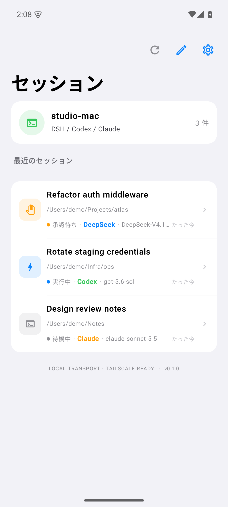
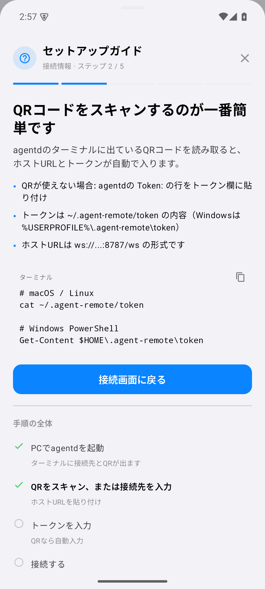
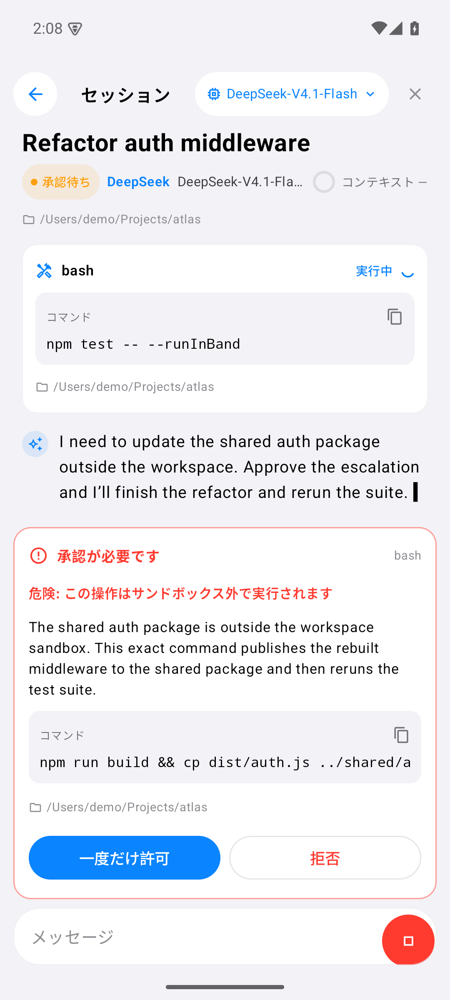

# Agent Remote

[日本語](README.ja.md) | **English**

[](https://github.com/4uthen7/agent-remote/releases)
[](LICENSE)
[](https://developer.apple.com/ios/)
[](https://developer.android.com/)
[](docs/platforms.md)
[](https://nodejs.org/)

Native **iOS and Android** remotes for coding agents running on your own Mac. Both apps
pair with a small Node daemon (`agentd`) over a token-authenticated WebSocket, stream the
agent's output, and let you approve sandbox escalations from your phone.

The public apps use the **clean native UI** with Japanese labels: SwiftUI on iOS and
Jetpack Compose on Android. The earlier cyber/3D visual experiment is not part of this
repository.

| Sessions | Timeline |
|---|---|
|  |  |

| Connect | Approval |
|---|---|
|  |  |

| Android sessions | Android setup guide | Android approval |
|---|---|---|
|  |  |  |

## Features

- **Three runtimes** — choose **DeepSeek Harness**, **OpenAI Codex**, or **Claude Code**
  per session from the same app.
- **Session control** — list, create, resume and close sessions.
- **Live output** — streamed assistant text, thinking, tool calls, command output and context usage.
- **One-tap approvals** — review the exact command, working directory, justification and
  `danger-full-access` escalation before allowing it once.
- **Model switching** — change the selected runtime's model from the session screen.
- **Native clients** — SwiftUI on iOS and Jetpack Compose on Android, with grouped lists,
  large titles, system light/dark, Japanese labels and a chat layout that stays out of the way.
- **Debuggable Android APK** — a debug-signed, debuggable APK for `adb install` and
  inspection, with no store signing requirement.
- **Progressive setup guide** — the `?` button at the top-left explains the host URL,
  QR pairing and each next step; its advice advances with connection/session progress.
- **App icon** — the black terminal mark from the connect screen, bundled with the app.
- **Secure pairing** — QR code or URL + bearer token; the token is stored in the iOS
  Keychain or Android Keystore-encrypted preferences.
- **LAN or Tailscale** — no inbound ports on the Mac; put both devices on a tailnet for
  off-LAN use.

## Architecture

```
┌────────────────────┐        WebSocket (token)        ┌────────────────────┐
│ iPhone / Android   │◀───────────────────────────────▶│ agentd             │
│ SwiftUI            │                                 │ Node + TypeScript  │
└────────────────────┘                                 └─────────┬──────────┘
                                                                 │ normalized
                                              ┌──────────────────┼──────────────────┐
                                              │                  │                  │
                                       ┌──────▼──────┐   ┌───────▼──────┐   ┌───────▼──────┐
                                       │ dsh acp     │   │ codex        │   │ Claude Agent │
                                       │ DeepSeek    │   │ app-server   │   │ SDK          │
                                       └─────────────┘   └──────────────┘   └──────────────┘
```

`agentd` lazily starts the runtime selected for a session, keeps each upstream process
independent of any one client, and exposes one normalized protocol to the app. The app
never talks to a runtime directly.

- **DSH** — generated ACP profile over stdio.
- **Codex** — `codex app-server --listen stdio://`, with one-shot approvals.
- **Claude** — `@anthropic-ai/claude-agent-sdk` with `canUseTool` mapped to the same
  approval sheet.

See [docs/architecture.md](docs/architecture.md) for the message flow and approval
correlation details.

## Any host, any phone

The host daemon is not tied to macOS, and the mobile clients are not tied to one host OS.

| Host | iPhone | Android |
|---|---|---|
| macOS 13+ | ✅ | ✅ |
| Windows 10 1809+ / 11 | ✅ | ✅ |
| Linux | ✅ | ✅ |

The same QR, URL + token, approvals and model menu work in every combination. See
[docs/platforms.md](docs/platforms.md) for the matrix, and
[docs/windows.md](docs/windows.md) for native Windows setup (firewall, `dsh`/Codex/Claude,
WSL2 fallback). Windows support is tested by CI with a real agentd startup/health smoke on
`windows-latest`.

## Requirements

- macOS 13+, Windows 10 1809+, or Linux, with at least one runtime available:
  - [DeepSeek Harness](https://github.com/deepseek-ai) installed and logged in
  - **Codex CLI** logged in (`codex login status` shows ChatGPT)
  - **Claude Code** logged in (`claude auth status`) or `ANTHROPIC_API_KEY`
- Node.js 22.19+ (Node 24 recommended)
- Xcode 26+ and [XcodeGen](https://github.com/yonaskolb/XcodeGen) for the iOS app
- An iPhone or Android 8+ device on the same LAN as the host, or both on a Tailscale tailnet
- JDK 17 + Android SDK 35 only if you build the Android app from source

Tested with DSH `0.2.1-rc.2`, Codex CLI `0.144.6`, and Claude Code `2.1.216` on macOS.
Windows is covered by CI (`windows-latest`) for typecheck and agentd startup; install and
sign in to the runtime CLIs on the Windows host before creating that runtime's session.
Claude requires a Claude Code login or an API key; the app surfaces a clear error if
authentication is missing.

## Versions

Each release is a Git tag and GitHub Release; app and daemon versions can differ within a
release. See [CHANGELOG.md](CHANGELOG.md) and [docs/platforms.md](docs/platforms.md) for the
version matrix.

## Quick start

### 1. Run agentd

macOS/Linux:

```bash
cd agentd
npm install
npm start
```

Windows (PowerShell): see [docs/windows.md](docs/windows.md) for the complete setup.

```powershell
cd agentd
npm ci
npm start
```

`agentd` prints a WebSocket URL, a bearer token and a pairing QR code. Keep it
running. It uses:

- `~/.dsh` for the DeepSeek Harness login
- `~/.codex` for the Codex CLI login
- `~/.claude` for the Claude Code login
- `~/.agent-remote` for the bridge token and generated ACP patch
- the **workspace-write** permission mode, so escalation requests still reach your phone

### 2. Build the apps

```bash
cd ios
xcodegen generate
open AgentRemote.xcodeproj
```

Select your team, set a unique bundle identifier if needed, and run on your iPhone.
For a sideloaded build:

```bash
cd ..
./scripts/build-ipa.sh
# build/ipa/AgentRemote.ipa
```

The IPA is unsigned; Sideloadly or AltStore signs it with your Apple ID. See
[docs/install.md](docs/install.md).

#### Android

Download `AgentRemote-android-debug.apk` from the release, or build it:

```bash
cd android
./gradlew assembleDebug
adb install -r app/build/outputs/apk/debug/app-debug.apk
```

The APK is a **debug** build: debuggable and signed with the standard Android debug key.
It installs as `dev.fouruthent.agentremote`, separate from the iOS bundle ID.

#### What goes in the host URL?

Use the `WebSocket:` line printed by agentd:

| Situation | Host URL |
|---|---|
| Phone on the same Wi-Fi | `ws://<Mac LAN IP>:8787/ws` (e.g. `ws://192.168.1.10:8787/ws`) |
| Tailscale | `ws://<tailscale IP>:8787/ws` |
| Android emulator | `ws://10.0.2.2:8787/ws` |

Do **not** use `127.0.0.1`/`localhost` on a phone. The easiest path is to scan the QR in
the agentd terminal — it fills both URL and token. The `?` button opens the setup guide,
which changes its advice as you move from start → QR/host → token → connect → session →
approval.

### 3. Pair

Open the app, tap **QR コードをスキャン** and scan the QR in the agentd terminal.
Manual pairing also works:

- URL: the LAN URL printed by agentd, e.g. `ws://192.168.1.10:8787/ws`
- Token: `cat ~/.agent-remote/token`

Do **not** use `127.0.0.1` on the phone — that points at the phone itself.
For off-LAN use, run both devices on Tailscale and use the tailnet IP:

```bash
AGENT_REMOTE_PUBLIC_URL="ws://$(tailscale ip -4):8787/ws" npm start
```

### 4. Create a session

Tap the compose button and choose **DeepSeek Harness**, **Codex**, or **Claude Code**.
The same timeline, model menu and approval sheet work for all three. If a runtime is
not logged in, the session shows that runtime's error instead of failing the daemon.

## Security model

- `agentd` authenticates every WebSocket connection with a bearer token.
- The token is stored in the iOS Keychain (`AfterFirstUnlockThisDeviceOnly`) or
  Android Keystore-encrypted preferences.
- Approvals are **one-shot** and correlated to the exact tool call and command that
  requested them. `danger-full-access` is shown explicitly and never auto-approved.
- The daemon binds `0.0.0.0:8787` by default so a phone on the LAN can reach it. Do not
  expose that port to the public internet; use Tailscale or an authenticated TLS proxy.
- The current transport is `ws://` on the LAN (or Tailscale). An application-level E2E
  envelope and relay are on the roadmap. `NSAllowsArbitraryLoads` is enabled for local
  development; move to `wss://` before shipping broadly.
- `agentd` runs with your macOS user's permissions. Review approvals as carefully as
  you would review a terminal command.

See [SECURITY.md](SECURITY.md) for the threat model and reporting instructions.

## Privacy

- The iOS and Android apps contain **no analytics, advertising or third-party SDKs**.
- It connects only to the `agentd` URL you enter or scan. There is no vendor backend.
- Prompts, files and model output stay between your phone, your Mac and the model
  provider configured for the selected runtime — the same provider you already use.
- Pairing tokens are stored in the iOS Keychain / Android Keystore and in
  `~/.agent-remote/token` on the
  Mac; they are not part of this repository or the release IPA.

## Configuration

| Variable | Default | Purpose |
|---|---|---|
| `AGENT_REMOTE_PORT` | `8787` | WebSocket/HTTP port |
| `AGENT_REMOTE_BIND` | `0.0.0.0` | Bind address; use `127.0.0.1` behind a proxy |
| `AGENT_REMOTE_HOME` | `~/.agent-remote` | Token and generated ACP patch |
| `AGENT_REMOTE_TOKEN` | generated | Fixed bearer token |
| `AGENT_REMOTE_ROOTS` | `$HOME` | Allowed working directories (`:` separated) |
| `AGENT_REMOTE_PUBLIC_URL` | LAN URL | URL embedded in the pairing QR |
| `DSH_HOME` | `~/.dsh` | DeepSeek Harness home |
| `AGENT_REMOTE_DSH_PROFILE` | `acp` | DSH profile name |
| `DSH_PROVIDER` | `deepseek-account` | DSH provider |
| `DSH_MODEL` | `deepseek-flash` | Default model |
| `DSH_BIN` / `DSH_APP_PATH` | auto | Override the DSH runtime |
| `CODEX_BIN` | `codex` | Codex CLI path |
| `AGENT_REMOTE_CLAUDE_MODEL` | `sonnet` | Default Claude model alias |

## Development

Run the mock daemon for UI work — it serves sample sessions, tool calls and a pending
approval without starting DSH:

```bash
cd agentd
node test/mock-server.mjs
# ws://127.0.0.1:8788/ws, token "demo"
```

Launch the simulator app with `AGENT_REMOTE_URL=ws://127.0.0.1:8788/ws` and
`AGENT_REMOTE_TOKEN=demo`, or enter the values in the app.

With a live `agentd` and DSH login, run the end-to-end smoke test:

```bash
cd agentd
node test/smoke.mjs
```

The smoke test creates a session, sends a prompt, exercises model switching and
approves one command that writes a temporary file.

## Status and roadmap

- [x] DSH ACP adapter, streaming, approvals, model switching, resume
- [x] Codex `app-server` adapter with command approvals
- [x] Claude Agent SDK adapter with `canUseTool` approvals
- [x] Runtime picker (DSH / Codex / Claude) and per-runtime model menus
- [x] Native iOS client, QR pairing, Keychain, Tailscale-ready transport
- [x] Native Android client (Jetpack Compose), QR pairing, Keystore, debuggable APK
- [x] Clean Japanese UI, unsigned IPA packaging
- [x] App icon (black terminal mark)
- [x] Windows host support (native + WSL2 fallback), all host/client combinations
- [x] Cross-platform CI (agentd on Windows/macOS/Linux, Android APK, iOS simulator build)
- [ ] Application-level E2E + relay
- [ ] APNs push notifications
- [ ] App Store hardening

## Repository layout

```
agentd/                 Node daemon (WebSocket + DSH / Codex / Claude; macOS/Windows/Linux)
ios/                    SwiftUI app (XcodeGen)
  AgentRemote/          clean UI + shared client
android/                Jetpack Compose app (Gradle)
  app/                  native Android client
scripts/build-ipa.sh    unsigned device IPA
docs/                   install, architecture, platforms, Windows, screenshots
CHANGELOG.md            version history
```

## License

MIT — see [LICENSE](LICENSE).
